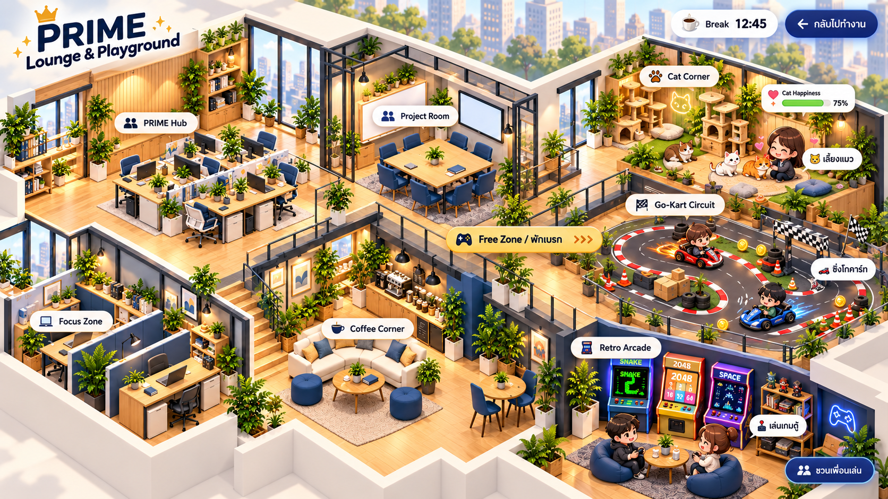

# PRIME Lounge & Playground — ภาพร่าง v1

วันที่: 14 ตุลาคม 2026

ภาพคอนเซ็ปต์เท่านั้น ยังไม่ได้เปลี่ยนแผนที่ในแอปหรือพัฒนากิจกรรมจริง

คงห้องเดิมสี่ห้องไว้ทางซ้าย เพิ่ม Free Zone ทางขวาเชื่อมด้วยทางเดินจาก Coffee Corner:

- Cat Corner: แมวสามตัว พื้นที่ลูบแมว ให้อาหาร และหลอดความสุขรวมของทีม
- Go-Kart Circuit: สนามวนพร้อมกรวย กล่อง เหรียญ และรถของสมาชิก
- Retro Arcade: ตู้เกมเดี่ยวและมุมนั่งเล่นกับเพื่อน
- ทางเข้า Free Zone และสถานะกิจกรรมแยกจากห้องทำงาน
- ตัวจับเวลาพักและปุ่มกลับไปทำงานด้านบน

ตัวเลขเวลาและคะแนนในภาพเป็นตัวอย่าง ปุ่มและตัวละครเป็นส่วนหนึ่งของภาพร่าง ยังไม่โต้ตอบได้

## การสร้างภาพ

เครื่องมือ: built-in imagegen (image edit)

ภาพต้นทาง: `public/assets/office.png` เก็บภาพต้นทางไว้ตามเดิม

Final prompt:

> Use case: compositing / ui-mockup. Edit and expand the attached existing PRIME isometric office map into one polished integrated concept illustration for 'PRIME Lounge & Playground'. Preserve recognizably the original four rooms, their exact furniture character and relative positions: upper left shared desks PRIME Hub, upper right glass meeting Project Room, lower left private desks Focus Zone, lower right sofa cafe Coffee Corner. Preserve warm natural wood, navy seating, abundant plants, sunny windows and attractive soft 3D cartoon/isometric cutaway style. Expand canvas to a wide laptop landscape approximately 16:9 and zoom out to show a newly attached recreation wing, not a collage and not a separate inset. Existing office occupies left 55-60%, new Free Zone wing occupies right 40-45%, joined by a clearly visible broad walkway directly from Coffee Corner. All rooms connected on a coherent architectural floor with consistent perspective, scale and lighting. New wing contains three distinct comfortably sized activity spaces: cozy Cat Corner with three adorable orange, white and brown cats, cat tree, scratching tower, cushions, food bowls and an adult chibi teammate petting a cat with floating hearts; Go-Kart Circuit with a continuous miniature loop track, clear asphalt lane, red-white curbs, cones, parcel obstacles, gold collectible coins, two small go-karts with adult chibi drivers, start-finish line; Retro Arcade with three colorful retro arcade cabinets, one snake screen, one 2048 screen, a small multiplayer lounge table and two adult chibi teammates. Keep recreation away from office desks, tracks confined to new wing. Tasteful functional floating UI concept elements: top-left compact title 'PRIME Lounge & Playground'; small room labels 'PRIME Hub', 'Project Room', 'Focus Zone', 'Coffee Corner'; highlighted pill 'Free Zone / พักเบรก' at the connecting walkway; new area labels 'Cat Corner', 'Go-Kart Circuit', 'Retro Arcade'. A compact top-right break timer pill '☕ Break 12:45' with return button 'กลับไปทำงาน'. Near cats one unobtrusive happiness meter 'Cat Happiness 75%' and near arcade small button 'ชวนเพื่อนเล่น'. A few cute avatar status bubbles '🐱 เลี้ยงแมว', '🏎️ ซิ่งโกคาร์ท', '🕹️ เล่นเกมตู้' only in Free Zone. Clearly legible labels with restrained clean type, no long explanatory text, no leader lines or infographic panels. Beautiful detailed professional game environment concept with breathing room, not cluttered, no watermark. This is only a proposed integrated map visual, not a real functioning app screenshot.
